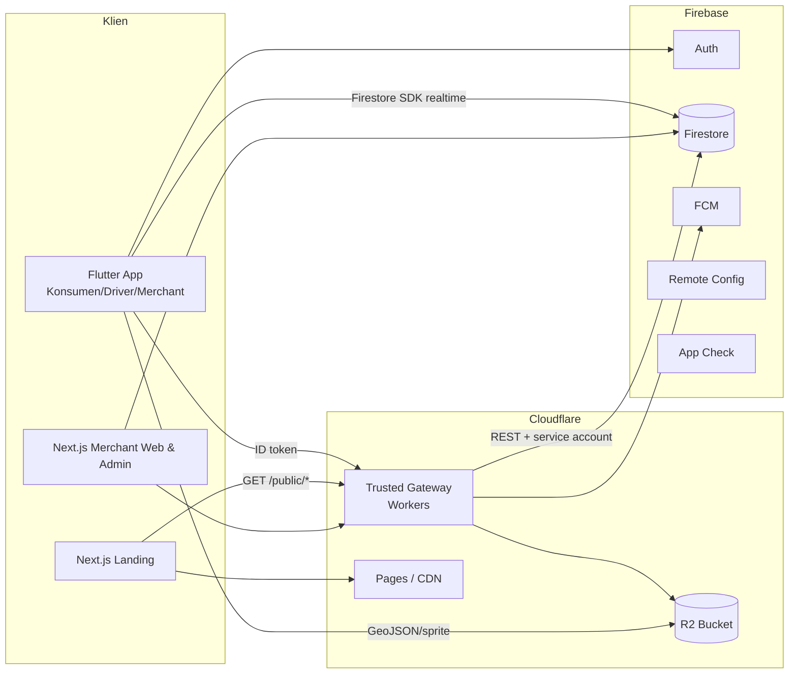
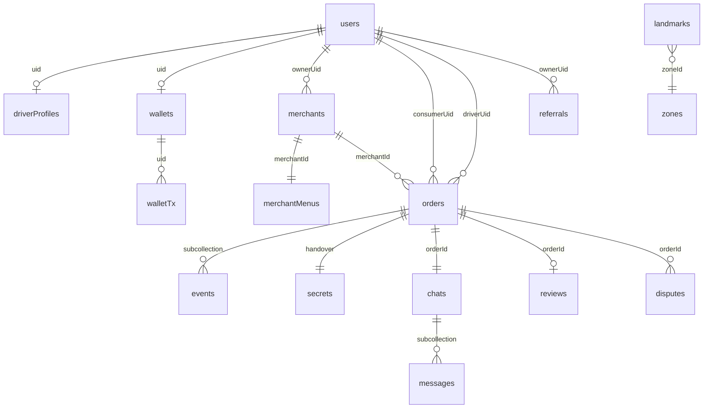
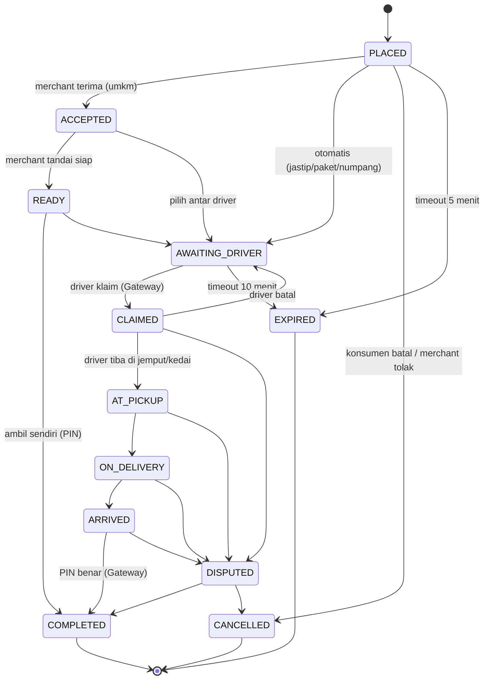
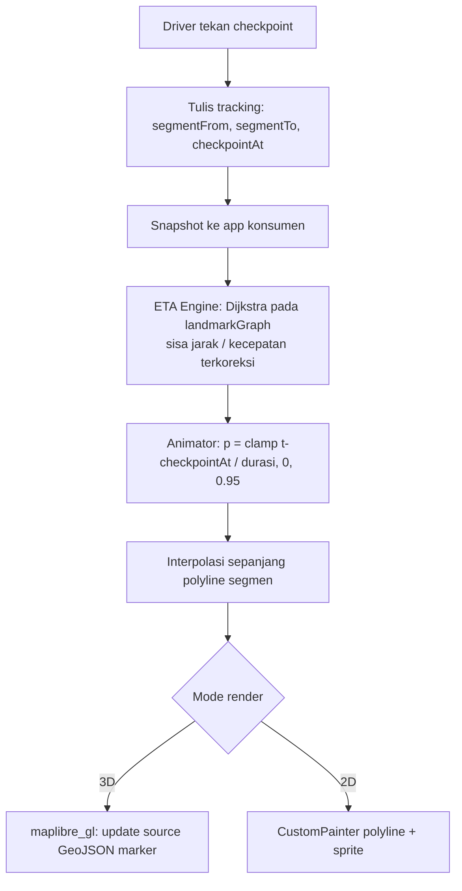

# Architecture — Campus Express (Go-Campus)

## 1. Prinsip Desain

| # | Prinsip | Konsekuensi |
|---|---|---|
| 1 | Hemat kuota sebelum hemat kode | Baca/tulis Firestore dianggarkan per fitur; data publik di-cache di edge |
| 2 | Klien tidak dipercaya | Transisi sensitif (klaim, PIN, komisi, top-up) dieksekusi oleh Trusted Gateway |
| 3 | Event-based, bukan stream-based | Pelacakan lewat checkpoint landmark, bukan GPS tiap detik |
| 4 | Satu sumber kebenaran | Status order hanya berubah lewat mesin status tunggal |
| 5 | Degradasi anggun | Peta 3D → 2D, realtime → polling, online → baca cache |

## 2. Diagram Konteks



## 3. Komponen

| Komponen | Teknologi | Tanggung jawab | Hosting (gratis) |
|---|---|---|---|
| Mobile app | Flutter, Riverpod, go_router | Seluruh 22 layar | Play Store / TestFlight |
| Peta | `maplibre_gl` (gaya GeoJSON kustom) + fallback `CustomPainter` | Render 3D/2D | Aset di R2 |
| Landing | Next.js 15, Tailwind, Framer Motion | Marketing & referral | Cloudflare Pages |
| Merchant web & Admin | Next.js (App Router) | Dasbor merchant dan panel admin | Cloudflare Pages |
| Auth | Firebase Auth (Google) | Identitas, custom claim `admin` | Firebase |
| Data & chat | Cloud Firestore | Order, chat, katalog, wallet | Firebase |
| Trusted Gateway | Cloudflare Workers (TypeScript) | Klaim atomik, PIN, komisi, unggah, endpoint publik | Cloudflare |
| Penyimpanan | Cloudflare R2 | Gambar WebP, KTM/SIM, bukti bayar, GeoJSON | Cloudflare |
| Push | FCM | Notifikasi | Firebase |
| Flag & versi | Remote Config | Kill switch, min versi app | Firebase |

### 3.1 Opsi Trusted Gateway

| Opsi | Kapan | Catatan |
|---|---|---|
| A. Cloudflare Workers | Pilot dan fase awal | Kuota gratis harian; tidak memerlukan paket Firebase berbayar |
| B. Cloud Functions 2nd gen | Saat migrasi ke Blaze | Satu kode logika yang sama dapat dipindahkan karena Gateway hanya berisi fungsi murni + akses Firestore |

Gateway ditulis sebagai modul fungsi murni (`claimOrder`, `verifyHandoverPin`, `completeOrder`, `approveTopup`) sehingga adaptor Workers dan Functions hanya tipis.

## 4. Skema Firestore

Konvensi: nama koleksi `camelCase`; uang integer Rupiah; waktu `Timestamp`; setiap dokumen mutable memiliki `updatedAt` dan `schemaVersion`.

### 4.1 ERD



### 4.2 Koleksi Inti

#### `users/{uid}`

| Field | Tipe | Keterangan |
|---|---|---|
| `displayName` | string | Dari Google |
| `email` | string | Wajib `@mhs.uin.ac.id` |
| `photoUrl` | string | Opsional |
| `nim` | string | Unik; dijaga oleh dokumen indeks `nimIndex/{nim}` |
| `phone` | string | Format E.164 Indonesia |
| `roles` | array\<string\> | Subset `consumer`, `driver`, `merchant` |
| `activeRole` | string | Peran yang sedang dipakai UI |
| `status` | string | `active`, `suspended` |
| `strikes` | map | `{count, lastAt}` |
| `blockedUids` | array\<string\> | Maks. 50 |
| `fcmTokens` | array\<string\> | Maks. 5 |
| `referralCode` | string | 6 karakter |
| `referredBy` | string? | Kode pengundang |
| `createdAt`, `updatedAt` | Timestamp | |

#### `driverProfiles/{uid}`

| Field | Tipe |
|---|---|
| `status` | `pending_docs`, `pending_review`, `approved`, `rejected`, `suspended` |
| `docs` | `{ktmKey, simKey, uploadedAt}` (kunci objek R2 privat) |
| `vehicle` | `{type, plate}` |
| `online` | bool |
| `activeJobs` | int (0–2, dikelola Gateway) |
| `ratingAvg`, `ratingCount` | number, int |
| `reviewedBy`, `reviewedAt`, `rejectReason` | |

#### `wallets/{uid}` (hanya tulis oleh Gateway)

| Field | Tipe |
|---|---|
| `balance` | int |
| `pendingCommission` | int (komisi estimasi order aktif) |
| `updatedAt` | Timestamp |

#### `walletTx/{txId}` (hanya tulis oleh Gateway)

| Field | Tipe |
|---|---|
| `uid` | string |
| `type` | `topup`, `commission`, `adjustment`, `refund` |
| `amount` | int (positif = masuk, negatif = keluar) |
| `balanceAfter` | int |
| `orderId` | string? |
| `proofKey` | string? (bukti top-up) |
| `status` | `pending`, `approved`, `rejected` |
| `approvedBy` | uid admin |
| `idempotencyKey` | string (unik per tipe+order) |

#### `merchants/{merchantId}`

| Field | Tipe |
|---|---|
| `ownerUid` | string |
| `name`, `description` | string |
| `landmarkId` | string |
| `isOpen` | bool |
| `schedule` | map hari → `{open, close}` |
| `prepTimeMin` | int |
| `qrisKey` | string (R2) |
| `payout` | `{bank, accountName, accountNoLast4}` (nomor penuh tidak disimpan di Firestore) |
| `status` | `pending`, `approved`, `suspended` |
| `ratingAvg`, `ratingCount` | |

#### `merchantMenus/{merchantId}` (satu dokumen per merchant, maks. 150 produk)

| Field | Tipe |
|---|---|
| `categories` | array\<{id, name, order}\> |
| `products` | array\<{id, name, price, imageKey, available, categoryId, optionGroups}\> |
| `optionGroups[]` | `{id, name, required, max, options[{id, name, priceDelta}]}` |
| `version` | int |

Satu dokumen menekan biaya baca katalog menjadi 1 baca per merchant.

#### `orders/{orderId}`

| Field | Tipe | Keterangan |
|---|---|---|
| `type` | string | `numpang`, `jastip`, `paket`, `umkm` |
| `status` | string | Lihat §5 |
| `consumerUid`, `merchantId?`, `driverUid?` | string | |
| `participants` | array\<string\> | Untuk rules chat |
| `items` | array | Snapshot nama, harga, opsi (tidak merujuk ke menu) |
| `pickup`, `dropoff` | map | `{landmarkId, note}` |
| `pricing` | map | `{subtotal, deliveryFee, total, commission}` |
| `payment` | map | `{method, status, proofKey?, confirmedBy?}` |
| `eta` | map | `{etaAt, computedAt, pathLandmarkIds[], speedMps}` |
| `tracking` | map | `{currentLandmarkId, segmentFrom, segmentTo, checkpointAt, segmentDurationSec}` |
| `prepReadyAt` | Timestamp? | |
| `expiresAt` | Timestamp | Timeout aktif saat ini |
| `idempotencyKey` | string | Dari klien saat membuat order |
| `version` | int | Penjaga optimistic locking |
| `createdAt`, `updatedAt`, `completedAt?` | Timestamp | |

#### `orders/{orderId}/events/{eventId}` — audit append-only

`{type, fromStatus, toStatus, actorUid, actorRole, at, meta}`

#### `orders/{orderId}/secrets/handover` — hanya konsumen dapat membaca

`{pin, attempts, lockedUntil?}`; tidak dapat ditulis klien.

#### `chats/{orderId}`

| Field | Tipe |
|---|---|
| `participants` | array\<string\> |
| `roles` | map uid → peran |
| `status` | `open`, `readonly`, `closed` |
| `lastMessage` | `{text, senderUid, at}` |
| `closesAt` | Timestamp? |

#### `chats/{orderId}/messages/{messageId}`

| Field | Tipe |
|---|---|
| `senderUid` | string |
| `type` | `text`, `chip`, `image`, `system` |
| `text` | string ≤ 500 |
| `imageKey` | string? |
| `clientId` | string (deduplikasi) |
| `createdAt` | Timestamp (server) |
| `readBy` | array\<string\> |
| `flagged` | bool |
| `expireAt` | Timestamp (TTL = createdAt + 30 hari) |

#### Koleksi Pendukung

| Koleksi | Kunci | Isi ringkas | Akses tulis |
|---|---|---|---|
| `landmarks` | `{id}` | `name, lat, lng, type, zoneId, active` | Admin |
| `zones` | `{id}` | `name, color` | Admin |
| `fareMatrix` | `{fromZone_toZone}` | `numpang, paket, jastipBase` | Admin |
| `config` | `app`, `landmarkGraph`, `catalogIndex` | Konstanta bisnis, graf, indeks merchant | Admin / Gateway |
| `reviews` | `{orderId}` | `consumerUid, driverRating, merchantRating, comment` | Konsumen (sekali) |
| `disputes` | `{id}` | `orderId, openedBy, category, evidenceKeys, status, resolution` | Peserta (buat), Admin (ubah) |
| `referrals` | `{code}` | `ownerUid, successCount` | Gateway |
| `salesPings` | `{id}` | `label, landmarkName, createdAt, expireAt` | Gateway |
| `stats` | `campus` | `orders, drivers, merchants, merchantsActive, savedRupiah` | Gateway |
| `auditLogs` | `{id}` | `actorUid, action, target, before, after, at` | Gateway |
| `nimIndex` | `{nim}` | `uid` | Gateway |

### 4.3 Indeks Komposit

| Koleksi | Field | Pemakaian |
|---|---|---|
| `orders` | `status ASC, createdAt DESC` | Radar driver (`status == AWAITING_DRIVER`) |
| `orders` | `consumerUid ASC, createdAt DESC` | Riwayat konsumen |
| `orders` | `driverUid ASC, createdAt DESC` | Riwayat driver |
| `orders` | `merchantId ASC, status ASC, createdAt DESC` | Order masuk merchant |
| `walletTx` | `uid ASC, createdAt DESC` | Riwayat wallet |
| `driverProfiles` | `status ASC, updatedAt ASC` | Antrean verifikasi |

## 5. Mesin Status Order



### 5.1 Tabel Transisi dan Pelaksana

| Dari | Ke | Pelaksana | Jalur |
|---|---|---|---|
| — | `PLACED` | Konsumen | Firestore + rules (server menghitung ulang `pricing` pada `onPlaced` Gateway; lihat §5.2) |
| `PLACED` | `ACCEPTED`/`CANCELLED` | Merchant / Konsumen | Firestore + rules |
| `ACCEPTED` | `READY`/`AWAITING_DRIVER` | Merchant | Firestore + rules |
| `AWAITING_DRIVER` | `CLAIMED` | Driver | Gateway (transaksi) |
| `CLAIMED` → `AT_PICKUP` → `ON_DELIVERY` → `ARRIVED` | Driver | Firestore + rules (hanya field `status`, `tracking`, `updatedAt`, `version`) |
| `ARRIVED`/`READY` | `COMPLETED` | Driver/Merchant | Gateway (verifikasi PIN, komisi) |
| Apa pun | `EXPIRED` | Sistem | Gateway terjadwal (Cron Trigger) |
| Apa pun | `DISPUTED`/`CANCELLED` (admin) | Admin | Gateway |

### 5.2 Penetapan Harga Tepercaya

Konsumen menulis order dengan `pricing` hasil hitungan klien. Gateway (dipicu klien lewat `POST /orders/{id}/finalize` segera setelah buat, dan oleh Cron untuk order yang tidak difinalisasi) menghitung ulang dari `fareMatrix` dan `merchantMenus`. Jika berbeda, order ditandai `EXPIRED` dengan alasan `PRICE_MISMATCH`. Driver tidak melihat order yang belum `finalized == true`.

## 6. Alur Data

### 6.1 Order End-to-End (umkm, antar driver)

```mermaid
sequenceDiagram
  participant K as Konsumen
  participant FS as Firestore
  participant G as Gateway
  participant M as Merchant
  participant D as Driver
  K->>FS: create orders (PLACED)
  K->>G: POST /orders/{id}/finalize
  G->>FS: validasi harga, set finalized, buat chats + secrets
  FS-->>M: snapshot order masuk
  M->>FS: status ACCEPTED, prepReadyAt
  M->>FS: status AWAITING_DRIVER
  FS-->>D: radar menerima order
  D->>G: POST /orders/{id}/claim
  G->>FS: transaksi: cek status, saldo, activeJobs; set CLAIMED, hold komisi
  loop checkpoint
    D->>FS: update tracking + status
    FS-->>K: snapshot (animasi 3D, ETA)
  end
  K-->>D: sebut/tunjukkan PIN
  D->>G: POST /orders/{id}/complete {pin}
  G->>FS: cek PIN, COMPLETED, potong komisi, salesPing, stats
```

### 6.2 Alur Animasi 3D



Semua perhitungan ETA dan interpolasi berjalan di perangkat konsumen; server tidak menyimpan koordinat per detik sehingga tidak ada biaya tulis tracking kontinu.

## 7. Arsitektur Landing Page

| Aspek | Keputusan |
|---|---|
| Rendering | Static export (`output: 'export'`); halaman dilayani dari CDN |
| Struktur | `app/(marketing)/page.tsx`, komponen di `components/landing/*` (lihat `tech.md`) |
| Data dinamis | Hanya Sales Pings, statistik, ulasan, dan referral; lewat `GET /public/*` di Gateway |
| Cache | `Cache-Control: public, s-maxage=30, stale-while-revalidate=60` sehingga Firestore hanya dibaca sekitar 2×/menit, tidak peduli jumlah pengunjung |
| Referral | Login Google di halaman, `POST /referrals/code` membuat atau mengambil kode; `/r/{kode}` menyimpan kode di `localStorage` lalu mengarahkan ke Play Store/tautan unduh |
| Animasi | Framer Motion; `prefers-reduced-motion` menonaktifkan animasi dekoratif |
| Performa | Target LCP < 2,5 dtk; gambar hero WebP; komponen berat dimuat dengan `dynamic()` |

## 8. Strategi Peta Gratis

| Kebutuhan | Solusi | Biaya |
|---|---|---|
| Basemap | Tidak ada tile eksternal; gaya MapLibre dari GeoJSON kampus sendiri | Rp 0 |
| Bangunan 3D | Layer `fill-extrusion` dengan properti `height_m` | Rp 0 |
| Marker kendaraan | Sprite isometrik pra-render (PNG) di Flutter; GLTF hanya pada varian Three.js web | Rp 0 |
| Routing | Dijkstra pada graf landmark di klien | Rp 0 |
| Distribusi aset | R2, egress gratis, cache 7 hari + versi pada nama berkas | Rp 0 |

Catatan: dukungan layer kustom GLTF pada plugin Flutter MapLibre perlu diverifikasi pada versi yang dipakai; desain ini sengaja tidak bergantung padanya.

## 9. Strategi Rp 0 dan Anggaran Kuota

Prinsip: pilot berjalan tanpa tagihan; pertumbuhan dikendalikan oleh anggaran kuota, bukan harapan.

### 9.1 Batas Gratis yang Menjadi Kendala

| Layanan | Batas gratis (verifikasi ulang di dokumentasi resmi sebelum rilis) | Pengaruh |
|---|---|---|
| Firestore (Spark) | ±50.000 baca, ±20.000 tulis, ±20.000 hapus per hari; 1 GiB penyimpanan | Kendala utama untuk 10.000 MAU |
| Firebase Auth | Google Sign-In tanpa biaya | Aman |
| FCM | Tanpa biaya | Aman |
| Cloud Functions | Memerlukan paket berbayar (Blaze) | Karena itu Gateway memakai Workers |
| Workers (Free) | ±100.000 request/hari | Cukup untuk pilot |
| R2 | ±10 GB penyimpanan, jutaan operasi/bulan, egress gratis | Cukup; biasanya perlu metode pembayaran terdaftar |
| Cloudflare Pages / Firebase Hosting | Gratis untuk situs statis | Aman |

### 9.2 Anggaran Tulis per Order (rata-rata)

| Aktivitas | Tulis |
|---|---|
| Buat order + events | 1 + 2 |
| Finalize (chat, secret, flag) | 3 |
| Terima merchant + siap | 2 + 2 |
| Klaim + hold | 2 |
| Checkpoint (3) | 3 + 3 events |
| Chat (±12 pesan) | 12 + 1 |
| Selesai (status, wallet, tx, ping, stat) | 6 |
| **Total** | **≈ 37** |

Dengan batas ±20.000 tulis/hari, kapasitas aman ≈ 400 order/hari (margin 25%). Cron, moderasi, dan admin ikut memakai kuota yang sama.

### 9.3 Anggaran Baca

| Tindakan | Baca per hari aktif per pengguna | Strategi |
|---|---|---|
| Buka Home | 2 | `config/catalogIndex` + `stats/campus` |
| Buka katalog merchant | 1 per merchant | Satu dokumen menu |
| Tracking aktif | 1 per perubahan | Listener hanya di dokumen order |
| Radar driver | 1 per order baru × driver online | Query dibatasi 20 dokumen, hanya `finalized == true` |
| Landing/publik | ±2 baca/menit total | Cache edge |

Target: ≤ 12 baca per DAU. Dengan ±50.000 baca/hari, kapasitas aman ≈ 3.000 DAU atau ±10.000 MAU jika rasio DAU/MAU ≤ 30%. Kapasitas tulis (±400 order/hari) menjadi batas yang lebih ketat.

### 9.4 Keputusan Fase

| Fase | Paket | Syarat naik |
|---|---|---|
| Pilot (≤ ±1.500 MAU) | Spark + Workers Free + R2 free | Tulis harian > 70% batas selama 3 hari berturut-turut |
| Skala | Blaze dengan anggaran peringatan rendah dan batas pengeluaran manual di Cloud Billing | Biaya terukur; kuota gratis harian tetap berlaku |

Artinya target "Rp 0" realistis untuk pilot. Untuk 10.000 MAU, hampir pasti perlu paket pay-as-you-go dengan biaya kecil namun tidak nol; ini sebaiknya diumumkan ke tim sejak awal. Lihat `Monetization.md` §7 untuk keseimbangan pendapatan vs biaya.

### 9.5 Pengendalian Biaya

| Kontrol | Detail |
|---|---|
| Throttle tulis klien | Chat 20 pesan/menit; checkpoint hanya satu per segmen |
| TTL | `messages.expireAt` 30 hari; `salesPings.expireAt` 24 jam; `events` order > 180 hari diarsipkan |
| Peringatan | Cloud Monitoring + Cron Worker yang membaca metrik dan memberi tahu admin pada 70% / 90% |
| Kill switch | Remote Config `chatEnabled`, `trackingEnabled`, `landingPingsEnabled` |
| Anti pemborosan | Pagination 20, `limit()` pada semua query, hindari `onSnapshot` pada koleksi besar |

## 10. Keamanan di Level Arsitektur

Ringkasan; rinci di folder `Security/` dan `threat-model.md`.

| Lapisan | Kontrol |
|---|---|
| Identitas | Google SSO + pengecekan domain di rules dan Gateway |
| Integritas klien | Firebase App Check (Play Integrity) aktif pada Firestore dan Gateway |
| Otorisasi | Rules berbasis peran + kepemilikan; Gateway memverifikasi ID token dan peran |
| Data sensitif | KTM/SIM di bucket privat; akses lewat URL bertanda tangan jangka pendek |
| Audit | `events` dan `auditLogs` append-only |

## 11. Observabilitas

| Sinyal | Alat | Ambang |
|---|---|---|
| Crash | Firebase Crashlytics | Crash-free sessions < 99% |
| Error Gateway | Workers Logs / `console.error` terstruktur | > 2% error 5xx |
| Kuota | Firestore usage dashboard | 70% peringatan |
| Latensi klaim | Log Gateway `claim_ms` | p95 > 800 ms |
| Bisnis | Ekspor mingguan ke Sheets | Order, dispute, driver aktif |

## 12. Keputusan Arsitektur (ADR Ringkas)

| ID | Keputusan | Alternatif | Alasan |
|---|---|---|---|
| ADR-1 | Firestore untuk chat dan order | Realtime Database | Spark RTDB membatasi 100 koneksi simultan; Firestore tidak memiliki batas tersebut |
| ADR-2 | Gateway di Workers | Cloud Functions | Tidak butuh paket berbayar saat pilot |
| ADR-3 | Tracking checkpoint | GPS streaming | Menghemat tulis > 90% dan baterai |
| ADR-4 | GeoJSON kustom | Tile vektor/Google Maps 3D | Nol biaya, tema konsisten |
| ADR-5 | Menu dalam satu dokumen | Subkoleksi produk | 1 baca per katalog |
| ADR-6 | Chat tidak E2EE | E2EE | Moderasi dan dispute memerlukan akses bukti |
| ADR-7 | PIN diverifikasi server | Verifikasi klien | Mencegah penyelesaian order palsu dan klaim komisi manipulatif |