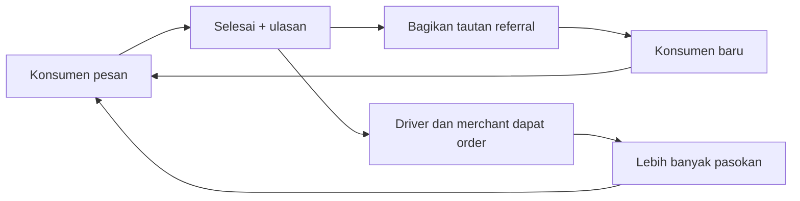

# Bussiness — Strategi Bisnis Campus Express

> Catatan: angka kompetitor (komisi, ongkir, cakupan) pada dokumen ini adalah asumsi kerja dan harus diverifikasi dari sumber resmi terbaru sebelum dipakai dalam materi publik. Angka proyeksi adalah skenario, bukan prediksi.

## 1. Ringkasan Peluang

| Aspek | Isi |
|---|---|
| Titik awal | Grup WhatsApp 800+ anggota yang sudah menjadi pasar nyata untuk jastip dan tumpangan |
| Proposisi nilai | Pemesanan terstruktur, status dan ETA terlihat, komisi 0,5%, khusus kampus |
| Keunggulan lokal | Peta landmark kampus, kenal komunitas, PIN serah-terima, chat dalam aplikasi |
| Risiko utama | Pendapatan per transaksi sangat kecil; ketergantungan pada pasokan driver lokal |

## 2. Segmentasi dan Kebutuhan

| Segmen | Ukuran awal (asumsi) | Masalah | Nilai Campus Express |
|---|---|---|---|
| Mahasiswa konsumen | Seluruh mahasiswa kampus pilot; 800+ sudah di grup WA | Pesan tenggelam di grup, tidak ada status | Order terstruktur, tracking, riwayat |
| Mahasiswa driver | Puluhan hingga ratusan | Penghasilan tidak tercatat, risiko tombok | Order jelas, komisi sangat kecil, bukti serah-terima |
| UMKM kampus | Kantin, kedai, laundry, fotokopi | Tidak punya kanal digital murah | Etalase gratis, order tertata |
| Pihak kampus | Organisasi mahasiswa, BEM, pengelola | Ingin ekosistem aman dan mandiri | Moderasi, laporan, kontrol |

## 3. Analisis Kompetitor

### 3.1 Perbandingan dengan Platform Besar (Gojek/Grab dan layanan makanan mereka)

| Dimensi | Platform besar | Campus Express | Implikasi |
|---|---|---|---|
| Komisi dari mitra | Umumnya persentase dua digit dari penjualan (asumsi kerja ±20% pada simulasi Price Roll; verifikasi) | 0,5% | Kunci pesan ke driver dan UMKM |
| Cakupan | Luas, termasuk ke dalam lingkungan kampus tertentu terbatas pada gerbang | Hiper-lokal, hingga landmark di dalam kampus | Kecepatan dan presisi titik antar |
| Titik antar | Alamat umum; sering berhenti di gerbang | Landmark preset (gedung, fakultas, asrama) | Mengurangi salah titik |
| Pembayaran | Dompet digital, kartu | COD dan QRIS statis | Kekurangan: tidak seamless |
| Skala promo | Besar, subsidi agresif | Tidak ada subsidi tunai | Jangan bersaing di harga promo |
| Layanan | Terstandar, terintegrasi | Jastip fleksibel (beli dari mana pun), kirim paket antar-titik | Fleksibilitas lokal sebagai pembeda |
| Kepercayaan | Merek nasional | Komunitas yang saling kenal, verifikasi NIM | Keamanan lewat identitas kampus |

### 3.2 Alternatif Lain

| Alternatif | Kekuatan | Kelemahan | Respons |
|---|---|---|---|
| Grup WhatsApp (kondisi saat ini) | Gratis, familiar | Tanpa status, tanpa audit, spam | Migrasi bertahap, WA tetap fallback darurat |
| Chat pribadi dengan driver langganan | Personal | Tidak skalabel, tidak ada jaminan | Fitur driver favorit (rilis lanjutan) |
| Pesan langsung ke kantin | Sederhana | Tidak ada antar | Katalog UMKM + driver |

### 3.3 Posisi

Campus Express bukan pesaing langsung platform besar di seluruh kota; ia melayani kebutuhan yang tidak dioptimalkan oleh mereka (lorong kampus, jastip, titik landmark, komunitas). Strategi: menjadi infrastruktur lokal yang lebih murah dan lebih cocok, bukan menandingi subsidi.

## 4. Strategi Pertumbuhan Kampus

### 4.1 Fase

| Fase | Durasi | Sasaran | Taktik | KPI keluar |
|---|---|---|---|---|
| 0. Persiapan | 4 minggu | Peta, graf landmark, dokumen, merekrut 10 driver awal dan 5 merchant | Survei pemetaan landmark, pelatihan driver | Graf landmark selesai; 10 driver + 5 merchant terverifikasi |
| 1. Pilot tertutup | 4 minggu | 100 order sukses | Undang 100 anggota grup WA dalam gelombang 25 | Dispute < 5%, crash-free > 98% |
| 2. Migrasi grup WA | 8 minggu | 70% order di aplikasi | Admin grup mengarahkan semua permintaan ke tautan aplikasi; format pesan grup diganti tombol "Pesan lewat aplikasi" | ≥ 70% order via aplikasi |
| 3. Perluasan | 12 minggu | 3.000 MAU | Referral, kolaborasi BEM/organisasi, kampanye landing | 3.000 MAU |
| 4. Skala kampus | 6 bulan | 10.000 MAU | Merchant lebih banyak, layanan tambahan | 10.000 MAU, 150 driver aktif |

### 4.2 Taktik Migrasi dari WhatsApp

| Taktik | Detail |
|---|---|
| Tautan dalam deskripsi grup | Setiap pesan permintaan jastip dibalas bot/admin dengan tautan aplikasi |
| Insentif non-tunai | Badge, prioritas pendaftaran driver, peringkat referral |
| Kemudahan awal | Order pertama dibantu pada layar pertama; video 30 detik |
| Peran admin grup | Admin grup menjadi duta; permintaan "numpang"/"jastip" tidak diproses di grup setelah tanggal tertentu |
| Fallback | WA tetap digunakan untuk keadaan darurat; komunikasi order di aplikasi |

### 4.3 Sisi Penawaran

| Aktor | Strategi rekrutmen |
|---|---|
| Driver | Rekrut dari pengguna aktif di grup WA; proses daftar < 5 menit; saldo awal Rp 10.000 dari top-up, bukan bonus |
| Merchant | Kunjungi langsung; bantu unggah 10 menu pertama; foto bersama; tanpa biaya |

### 4.4 Loop Pertumbuhan

## 5. Model Skenario

Asumsi: nilai rata-rata order Rp 30.000, komisi 0,5% = Rp 150.

| Skenario | MAU | Order/hari | Komisi/hari | Komisi/bulan (30 hari) |
|---|---|---|---|---|
| Pilot | 1.000 | 60 | Rp 9.000 | Rp 270.000 |
| Pertumbuhan | 3.000 | 180 | Rp 27.000 | Rp 810.000 |
| Target | 10.000 | 600 | Rp 90.000 | Rp 2.700.000 |

Pada skenario target, 600 order/hari melebihi kapasitas tulis gratis Firestore (±400 order/hari; lihat `Architecture.md` §9), sehingga biaya infrastruktur kemungkinan mulai muncul; pendapatan komisi masih jauh lebih besar dari biaya tersebut, tetapi kecil sebagai bisnis.

## 6. Keberlanjutan Finansial

Komisi 0,5% menjaga nilai bagi driver dan UMKM, tetapi hampir tidak membiayai tim. Jalur pendapatan tambahan (rangkaian opsi, bukan komitmen):

| Opsi | Mekanisme | Risiko |
|---|---|---|
| Listing unggulan UMKM | Biaya promosi tetap kecil per minggu | Persepsi tidak adil |
| Sponsor kampus/brand | Slot banner terbatas di Home, label jelas | Kepercayaan, etika konten |
| Langganan driver premium | Fitur analitik pendapatan, prioritas radar | Keadilan antar-driver |
| Hibah/pendanaan kegiatan mahasiswa | Pendanaan inkubasi kampus | Ketergantungan |
| Layanan B2B kampus | Pengantaran dokumen administrasi | Kompleksitas |

Keputusan arah monetisasi perlu persetujuan tim dan pihak kampus; dokumen ini tidak menetapkannya.

## 7. Rencana Skala

| Tahap | Pemicu | Perubahan teknis | Perubahan operasional |
|---|---|---|---|
| Satu kampus, 3.000 MAU | Tulis harian > 70% kuota | Siapkan Blaze + anggaran peringatan | Tambah admin moderator |
| Satu kampus, 10.000 MAU | Order > 400/hari | Pindahkan Gateway ke opsi B bila perlu; optimasi baca | Tim moderator 3–5 orang |
| Multi-kampus | Permintaan dari kampus lain | Multi-tenant: `campusId` pada semua koleksi, peta dan graf per kampus, domain email per kampus | Komunitas lokal per kampus, pelatihan duta |
| Layanan baru | Kebutuhan terbukti | Modul terpisah dalam arsitektur yang sama | Uji pilot |

Prasyarat multi-kampus: menambahkan `campusId` sejak awal pada skema akan jauh lebih murah daripada migrasi nanti; disarankan memasukkannya pada rilis pertama sebagai field konstanta.

## 8. Risiko Bisnis

| Risiko | Probabilitas | Dampak | Mitigasi |
|---|---|---|---|
| Driver tidak cukup | Sedang | Tinggi | Rekrut sebelum membuka konsumen; target 1 driver per 60 konsumen aktif |
| Konsumen kembali ke WA | Tinggi pada awal | Sedang | Admin grup mendukung, nilai tracking dan riwayat |
| Insiden keamanan fisik/pelecehan | Rendah | Sangat tinggi | Verifikasi identitas, PIN, chat, Help Desk, kebijakan jelas |
| Kuota gratis habis | Sedang | Tinggi | Anggaran kuota, peringatan, rencana Blaze |
| Dukungan kampus tidak ada | Sedang | Sedang | Libatkan BEM/dosen pembimbing sejak awal |
| Tim kehabisan tenaga | Sedang | Tinggi | Dokumentasi, pembagian peran, otomasi moderasi |
| Platform besar masuk ke kampus | Rendah–sedang | Sedang | Fokus pada keunggulan lokal, tidak bersaing harga |

## 9. Metrik Utama

| Kategori | Metrik | Target 90 hari |
|---|---|---|
| Akuisisi | Pengguna terdaftar, % dari grup WA | 800 → 1.500 |
| Aktivasi | Order pertama dalam 7 hari setelah daftar | ≥ 50% |
| Retensi | Pengguna dengan ≥ 2 order/bulan | ≥ 35% |
| Pasokan | Driver aktif mingguan, waktu klaim median | 40, < 90 dtk |
| Kualitas | Rating rata-rata, dispute rate, selisih ETA | ≥ 4,5, < 3%, ≤ 4 menit |
| Keuangan | Komisi/bulan, biaya infrastruktur/bulan | Biaya ≤ komisi |