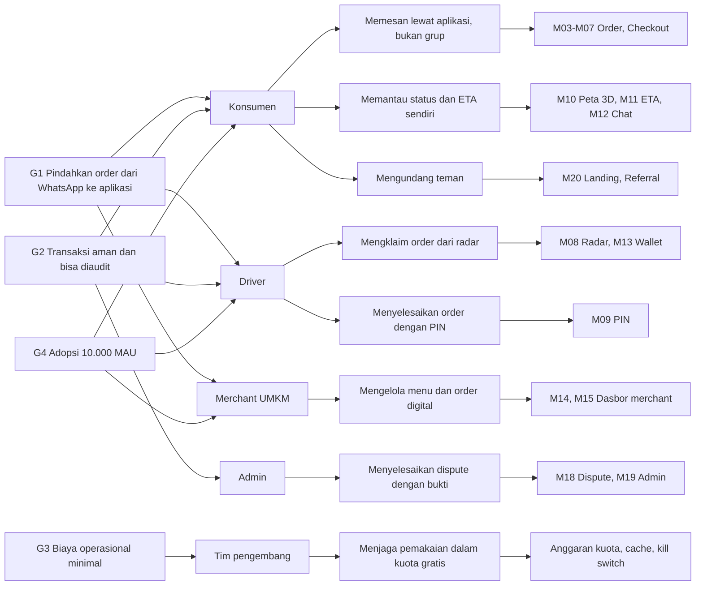

# Impact Map — Campus Express

Struktur: **Goal (Mengapa) → Actor (Siapa) → Impact (Bagaimana perilaku berubah) → Deliverable (Apa yang dibangun)**. Setiap deliverable merujuk ke modul di `PRD.md` agar dapat ditelusuri.

## 1. Diagram

## 2. Tabel Peta Dampak

### G1 — Memindahkan order dari WhatsApp ke aplikasi

| Aktor | Dampak yang diinginkan | Deliverable | Modul | Ukuran keberhasilan |
|---|---|---|---|---|
| Konsumen | Memesan lewat aplikasi karena lebih cepat dan jelas | Home Bento, pemilih landmark, katalog, checkout | M03–M06 | ≥ 70% order jastip/numpang di aplikasi |
| Konsumen | Berhenti bertanya "sudah sampai mana?" di grup | Peta 3D, ETA dinamis, status stepper | M10, M11 | ≥ 85% order dilacak |
| Konsumen | Berbicara dengan driver tanpa membuka nomor pribadi | Chat dalam aplikasi, Quick Chips | M12 | ≥ 90% komunikasi order via chat |
| Driver | Mendapat order tanpa memantau grup | Radar order, klaim 1-klik | M08 | Waktu klaim median < 90 dtk |
| Merchant | Menerima order tertata tanpa mencatat manual | Order masuk, dispatcher | M14 | ≥ 80% order UMKM diproses di aplikasi |
| Admin grup | Mengarahkan permintaan ke aplikasi | Tautan aplikasi, landing | M20 | Permintaan di grup menurun |

### G2 — Transaksi aman dan dapat diaudit

| Aktor | Dampak | Deliverable | Modul | Ukuran |
|---|---|---|---|---|
| Konsumen | Merasa aman karena serah-terima terverifikasi | PIN 4 digit, e-receipt | M09, M17 | Dispute rate < 3% |
| Driver | Terlindungi dari klaim palsu | Event audit, bukti chat, PIN | M07, M12 | Kasus tidak terselesaikan < 1% |
| Merchant | Pembayaran jelas | Konfirmasi QRIS, riwayat order | M06, M17 | Sengketa pembayaran < 1% |
| Admin | Memutus kasus cepat dan adil | Pusat dispute, audit log | M18, M19 | Tanggapan pertama ≤ 24 jam |
| Pengguna | Terbebas dari pelecehan | Moderasi chat, laporan, blokir | M12, M18 | Laporan berat diproses ≤ 24 jam |

### G3 — Biaya operasional minimal

| Aktor | Dampak | Deliverable | Ukuran |
|---|---|---|---|
| Tim pengembang | Menjaga biaya infrastruktur nol pada pilot | Tracking checkpoint, menu satu dokumen, cache edge, kompresi WebP 80 KB | Pemakaian harian < 70% kuota gratis |
| Tim pengembang | Mendeteksi lonjakan sebelum biaya muncul | Peringatan kuota, kill switch | Peringatan dikirim pada 70% |
| Admin | Mengurangi pekerjaan manual | Antrean persetujuan terstruktur | Waktu verifikasi driver < 10 menit |

### G4 — Adopsi 10.000 MAU

| Aktor | Dampak | Deliverable | Modul | Ukuran |
|---|---|---|---|---|
| Konsumen | Mengundang teman | Referral, Hero Banner | M20 | Koefisien viral ≥ 0,3 |
| Calon pengguna | Memahami nilai dalam 10 detik | Landing: Word Rotator, Bento Showcase, Price Roll | M20 | Konversi kunjungan → unduh ≥ 8% |
| Calon pengguna | Percaya karena ada bukti sosial | Sales Pings, Count-Up, Review Shuffle | M20 | Waktu di halaman > 45 dtk |
| Driver | Bergabung karena komisi kecil | Pendaftaran driver, wallet transparan | M13, Layar 20 | 150 driver aktif |
| Merchant | Bergabung karena gratis | Pendaftaran merchant, bantuan menu | M15 | 40 merchant aktif |

## 3. Matriks Keterlacakan Deliverable

| Deliverable | Layar | Goal terkait |
|---|---|---|
| Onboarding & peran | 1, 2 | G1, G4 |
| Home Bento | 3 | G1, G4 |
| Katalog, kustomisasi, checkout | 5, 6, 7 | G1 |
| Peta 3D + ETA + PIN | 8 | G1, G2 |
| Radar, pekerjaan aktif | 9, 10 | G1 |
| Wallet driver | 11 | G2, G3 |
| Dasbor dan order merchant | 12, 13, 17, 21 | G1 |
| Profil dan ulasan | 14, 19 | G4 |
| Admin | 15 | G2, G3 |
| Chat | 16 | G1, G2 |
| Riwayat dan struk | 18 | G2 |
| Registrasi driver | 20 | G2, G4 |
| Dispute & bantuan | 22 | G2 |
| Landing | — | G4 |

## 4. Asumsi dan Hipotesis yang Diuji

| Hipotesis | Cara uji | Keputusan jika salah |
|---|---|---|
| Konsumen mau pindah dari grup WA bila ada status dan ETA | Pilot: persentase order via aplikasi per minggu | Perkuat insentif dan peran admin grup |
| Driver mau top-up saldo untuk komisi 0,5% | Persentase driver terdaftar yang top-up dalam 7 hari | Turunkan ambang, tambahkan panduan |
| Checkpoint cukup untuk rasa "tracking" | Survei kepuasan, selisih ETA | Pertimbangkan GPS terbatas |
| Kuota gratis cukup untuk pilot | Pemantauan harian | Percepat migrasi ke Blaze |
| Reward non-tunai cukup memotivasi referral | Tingkat undangan yang berhasil | Cari sponsor UMKM untuk voucher |

## 5. Prioritas (berdasarkan dampak terhadap goal)

| Prioritas | Deliverable | Alasan |
|---|---|---|
| P0 | Auth, order, checkout, radar, klaim, PIN, wallet, chat | Tanpa ini tidak ada transaksi |
| P1 | Peta + ETA, merchant ops, dispute, admin | Pembeda utama dan keamanan |
| P2 | Landing, referral, review shuffle | Pertumbuhan |
| P3 | Dekorasi tambahan, animasi lanjutan | Dikerjakan setelah metrik P0–P1 stabil |