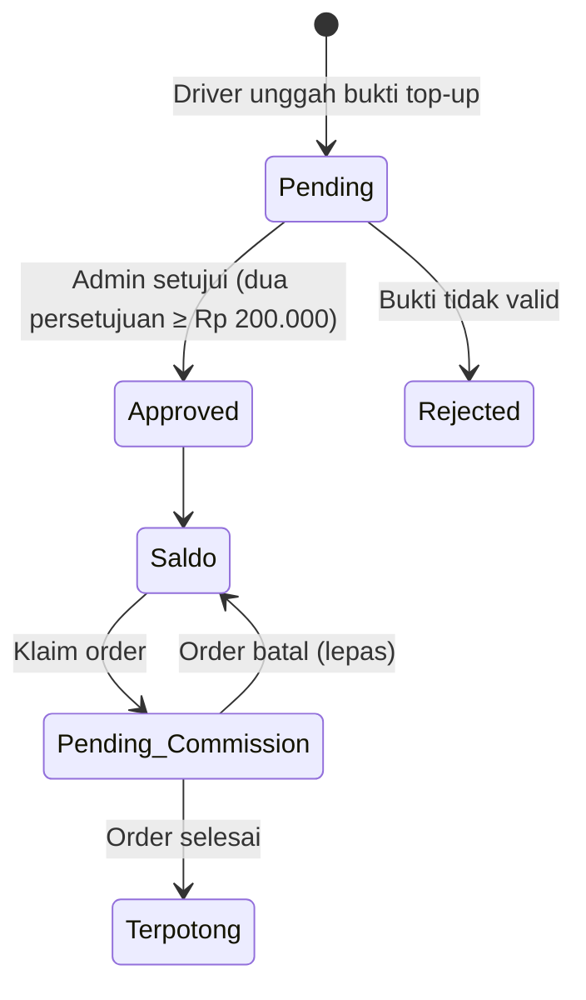
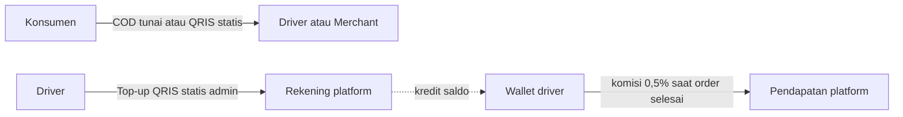

# Monetization — Campus Express

## 1. Ringkasan Model

| Aspek | Keputusan v1 |
|---|---|
| Sumber pendapatan | Komisi 0,5% per transaksi selesai |
| Pihak yang membayar | Driver (dipotong dari saldo deposit) |
| Pihak yang tidak dikenai | Konsumen (tanpa biaya layanan), merchant (tanpa komisi; lihat §6) |
| Pembayaran barang/jasa | Langsung antar pihak: COD tunai atau QRIS statis; platform tidak memegang dana transaksi |
| Mekanisme penagihan | Dompet deposit prabayar driver dengan ambang minimum |

Karena dana transaksi tidak melewati platform, risiko tunggakan komisi dihilangkan dengan membayar di muka (prepaid), bukan menagih belakangan.

## 2. Perhitungan Komisi

### 2.1 Definisi

```
total      = subtotal + deliveryFee          (Rupiah, integer)
commission = max(minCommission,
                 floor((total × commissionBps + 5000) / 10000))
```

Dengan `commissionBps = 50` dan `minCommission = 50`. Penambahan 5000 sebelum pembagian 10000 menghasilkan pembulatan setengah ke atas.

### 2.2 Contoh

| Layanan | Subtotal | Ongkir/tarif | Total | Komisi 0,5% | Komisi dipungut | Catatan |
|---|---|---|---|---|---|---|
| Numpang | 0 | 5.000 | 5.000 | 25 | **50** | Dikenai minimum |
| Jastip | 20.000 | 5.000 | 25.000 | 125 | **125** | |
| UMKM | 25.000 | 5.000 | 30.000 | 150 | **150** | Contoh umum |
| Jastip | 12.500 | 5.000 | 17.500 | 87,5 | **88** | Pembulatan ke atas |
| Paket | 0 | 7.000 | 7.000 | 35 | **50** | Minimum |
| UMKM | 120.000 | 8.000 | 128.000 | 640 | **640** | |
| Jastip maksimum | 495.000 | 5.000 | 500.000 | 2.500 | **2.500** | Batas total order |

### 2.3 Perbandingan dengan Komisi Besar (untuk widget Price Roll)

```
penghematan = total × (asumsiKomisiBesar − 0,005)
```

Dengan asumsi 20% (konfigurasi, wajib diberi label "asumsi" dan diverifikasi sebelum publikasi):

| Total | Komisi 20% | Komisi 0,5% | Selisih |
|---|---|---|---|
| 15.000 | 3.000 | 75 | 2.925 |
| 30.000 | 6.000 | 150 | 5.850 |
| 50.000 | 10.000 | 250 | 9.750 |
| 100.000 | 20.000 | 500 | 19.500 |

### 2.4 Siapa yang Menerima Komisi pada Tiap Layanan

| Layanan | Dasar komisi | Dipotong dari |
|---|---|---|
| Numpang | Tarif tetap | Wallet driver |
| Jastip | Harga struk + ongkir | Wallet driver |
| Kirim paket | Tarif tetap | Wallet driver |
| UMKM dengan antar driver | Subtotal + ongkir | Wallet driver |
| UMKM ambil sendiri | — | Tidak dikenai pada v1 |

## 3. Dompet Deposit Driver

### 3.1 Konsep

Dompet adalah saldo kredit komisi prabayar. Saldo bukan uang elektronik: tidak dapat ditransfer ke pengguna lain, tidak dipakai untuk membayar barang, hanya dipakai untuk komisi platform.

### 3.2 Parameter

| Parameter | Nilai | Alasan |
|---|---|---|
| `driverMinBalance` | Rp 5.000 | Menutup komisi terburuk dua order aktif (2 × Rp 2.500) |
| `maxActiveJobsPerDriver` | 2 | Menjaga tanggungan komisi tertutup |
| `driverLowBalanceWarn` | Rp 10.000 | Peringatan sebelum terkunci |
| `topupMin` | Rp 10.000 | Menekan biaya verifikasi admin |
| `topupMax` | Rp 500.000 per transaksi | Membatasi eksposur |
| Saldo negatif | Tidak diizinkan | Tidak ada tunggakan |

### 3.3 Aturan Klaim

```
available = balance − pendingCommission
bisaKlaim = status driver approved
          ∧ balance ≥ driverMinBalance
          ∧ available ≥ komisiEstimasi(order)
          ∧ activeJobs < maxActiveJobsPerDriver
```

Saat klaim berhasil: `pendingCommission += komisiEstimasi`. Saat order selesai: komisi aktual dipotong dan `pendingCommission -= komisiEstimasi`. Saat order batal: `pendingCommission -= komisiEstimasi` tanpa potongan.

### 3.4 Siklus Hidup Saldo



### 3.5 Ledger

`walletTx` adalah buku besar append-only.

| Tipe | Tanda | Pemicu | `idempotencyKey` |
|---|---|---|---|
| `topup` | + | Persetujuan admin | `topup:{txId}` |
| `commission` | − | Order `COMPLETED` | `commission:{orderId}` |
| `refund` | + | Koreksi komisi pada dispute | `refund:{disputeId}` |
| `adjustment` | ± | Koreksi manual admin dengan alasan | `adjust:{txId}` |

Invarian yang diperiksa harian:

| Invarian | Pemeriksaan |
|---|---|
| I1 | `wallets.balance = Σ walletTx.amount` (status `approved`) untuk tiap `uid` |
| I2 | Σ `commission` = Σ `pricing.commission` pada order `COMPLETED` pada periode yang sama |
| I3 | `balance ≥ 0` dan `pendingCommission ≥ 0` |
| I4 | Tidak ada dua `walletTx` dengan `idempotencyKey` sama |

Pelanggaran invarian memicu peringatan ke admin dan mem-pause top-up/klaim untuk akun terdampak hingga ditinjau.

## 4. Alur Keuangan

### 4.1 Aliran Dana



Dana pembelian tidak pernah masuk rekening platform. Satu-satunya dana yang diterima platform adalah deposit top-up driver.

### 4.2 Contoh Alur Lengkap (UMKM antar driver)

| Langkah | Peristiwa | Uang |
|---|---|---|
| 1 | Konsumen pesan nasi goreng Rp 25.000 + ongkir Rp 5.000 | — |
| 2 | Merchant terima, driver klaim | `pendingCommission += 150` |
| 3 | Driver menjemput, antar | — |
| 4 | Konsumen bayar COD Rp 30.000 ke driver; driver menyerahkan Rp 25.000 ke merchant | Antar pihak |
| 5 | PIN benar, order selesai | Wallet driver −150, ledger `commission` |
| 6 | Driver menyimpan Rp 5.000 ongkir | Penghasilan driver |

Saldo awal driver Rp 20.000 → Rp 19.850 setelah order. Pendapatan bersih driver per order: ongkir − komisi (Rp 5.000 − Rp 150 = Rp 4.850).

### 4.3 Pembayaran QRIS Statis

| Langkah | Detail |
|---|---|
| Penerima | QRIS statis merchant (umkm) atau driver (jastip/paket/numpang) |
| Konsumen | Bayar, unggah bukti |
| Penerima | Konfirmasi "Pembayaran Diterima" |
| Platform | Tidak memverifikasi dana secara otomatis; pencatatan dan bukti saja |

Risiko: bukti palsu dan konfirmasi sengaja ditunda. Mitigasi di `Rules.md` BR-P2/BR-P4 dan dispute.

### 4.4 Top-Up Driver

| Langkah | Detail |
|---|---|
| 1 | Driver membuka Top-Up, memilih nominal (kelipatan Rp 1.000) |
| 2 | Aplikasi menampilkan QRIS statis admin dan kode unik 3 digit pada catatan untuk memudahkan pencocokan |
| 3 | Driver bayar dan unggah bukti (WebP ≤ 80 KB) |
| 4 | Admin mencocokkan dengan mutasi rekening, lalu menyetujui |
| 5 | Saldo bertambah; notifikasi FCM |
| 6 | Nominal ≥ Rp 200.000 memerlukan persetujuan dua admin |

### 4.5 Penarikan Sisa Saldo

Driver yang berhenti dapat meminta pengembalian sisa saldo (dikurangi `pendingCommission`) lewat Help Desk. Admin memproses manual dalam 7 hari kerja, tercatat sebagai `adjustment`. Karena ini menyangkut penyimpanan dana pengguna, kebijakan dan pemberitahuan syarat perlu ditinjau secara hukum sebelum peluncuran publik.

## 5. Hitungan Pendapatan dan Biaya

### 5.1 Rumus

```
pendapatanBulanan = ordersPerHari × 30 × rataRataTotal × 0,005
```

| Skenario | Order/hari | Rata-rata total | Pendapatan komisi/bulan |
|---|---|---|---|
| Pilot | 60 | Rp 30.000 | Rp 270.000 |
| Pertumbuhan | 180 | Rp 30.000 | Rp 810.000 |
| Target 10.000 MAU | 600 | Rp 30.000 | Rp 2.700.000 |

### 5.2 Sisi Biaya

| Komponen | Pilot | Skala |
|---|---|---|
| Firebase | Rp 0 (Spark) | Tergantung pemakaian setelah kuota gratis; ukur selama pilot |
| Cloudflare Workers/Pages/R2 | Rp 0 dalam kuota | Perlu dipantau |
| Play Store | Biaya pendaftaran satu kali | — |
| Domain | Biaya tahunan | — |
| Tenaga admin | Relawan | Insentif bila perlu |
| Biaya verifikasi top-up | Waktu admin | Otomasi bila volume besar |

Perkiraan biaya skala tidak diberikan angka karena bergantung tarif penyedia saat itu; hitung ulang dengan kalkulator harga resmi sebelum menaikkan paket.

## 6. Keputusan yang Perlu Dikonfirmasi Tim

| # | Keputusan | Default v1 | Alternatif |
|---|---|---|---|
| D1 | Komisi ambil sendiri UMKM | Tidak dikenai | Merchant wallet 0,5% |
| D2 | Dasar komisi | Subtotal + ongkir | Hanya ongkir (lebih rendah, lebih adil bagi driver jastip) |
| D3 | Reward referral | Non-tunai | Voucher sponsor UMKM |
| D4 | Penarikan sisa saldo | Manual via Help Desk | Tidak dapat ditarik (perlu tinjauan hukum) |
| D5 | Komisi minimum Rp 50 | Ya | Tanpa minimum |

## 7. Keberlanjutan

Pendapatan komisi pada skenario target (± Rp 2,7 juta/bulan) menutup biaya infrastruktur kecil tetapi bukan biaya tim. Opsi pendapatan tambahan dibahas di `Bussiness.md` §6. Evaluasi tiga bulanan: bila biaya infrastruktur melebihi 50% pendapatan komisi, tinjau parameter (`commissionBps`, `minCommission`) atau sumber pendapatan lain; perubahan komisi diumumkan 14 hari sebelum berlaku.

## 8. Kepatuhan dan Catatan Hukum

Dokumen ini bukan nasihat hukum. Sebelum peluncuran publik, tinjau dengan pihak berkompeten hal-hal berikut: status saldo prabayar dan kewajiban terkait, kewajiban perpajakan atas pendapatan komisi, ketentuan layanan tumpangan sepeda motor di lingkungan kampus, dan ketentuan perlindungan data pribadi untuk dokumen driver.