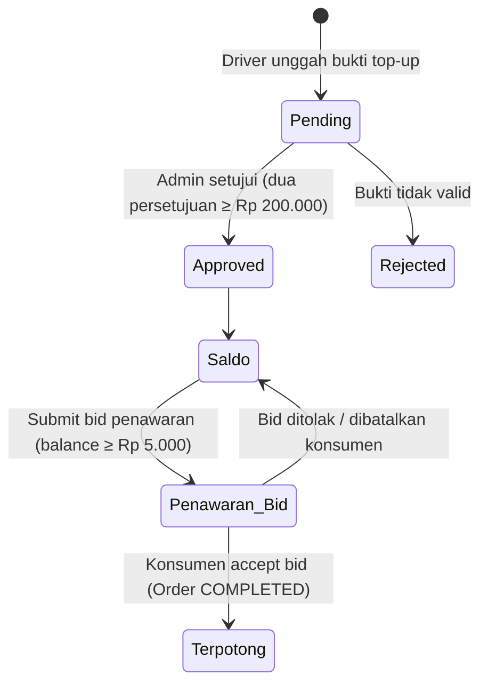
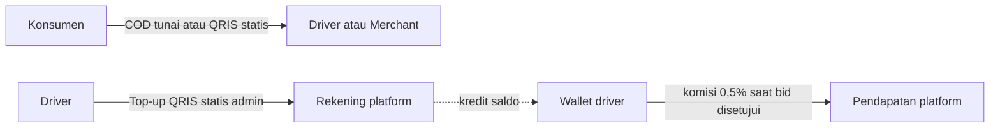

# Monetization — Campus Express

## 1. Ringkasan Model

| Aspek | Keputusan v1 (Bidding Model) |
|---|---|
| Sumber pendapatan | Komisi 0,5% per transaksi selesai |
| Pihak yang membayar | Driver (dipotong dari saldo deposit saat penawaran bid disetujui) |
| Pihak yang tidak dikenai | Konsumen (tanpa biaya layanan tambahan), merchant (tanpa komisi; lihat §6) |
| Pembayaran barang/jasa | Langsung antar pihak: COD tunai atau QRIS statis; platform tidak memegang dana transaksi |
| Mekanisme penagihan | Dompet deposit prabayar driver dengan ambang minimum saldo Rp 5.000 untuk dapat mengirim penawaran (bid) |

Karena dana transaksi tidak melewati platform, risiko tunggakan komisi dihilangkan dengan membayar di muka (prepaid), bukan menagih belakangan.

---

## 2. Perhitungan Komisi

### 2.1 Definisi

Pada model Reverse Auction (Bidding Engine), `finalPrice` ditentukan dari nominal penawaran driver (`offeredPrice`) yang disetujui oleh konsumen (`acceptBid`).

```
total      = finalPrice                      (Rupiah, integer)
commission = max(minCommission,
                 floor((total × commissionBps + 5000) / 10000))
```

Dengan `commissionBps = 50` (0,5%) dan `minCommission = 50` (Rp 50). Penambahan 5000 sebelum pembagian 10000 menghasilkan pembulatan setengah ke atas.

### 2.2 Contoh

| Layanan | Nominal Bid Disetujui (`finalPrice`) | Komisi 0,5% | Komisi Dipungut | Catatan |
|---|---|---|---|---|
| Numpang (Jarak Dekat) | Rp 4.000 | 20 | **50** | Dikenai minimum komisi |
| Nebeng / Numpang (Simpang Tuntungan) | Rp 7.000 | 35 | **50** | Dikenai minimum komisi (Rekomendasi OSRM) |
| Jastip Kantin | Rp 25.000 | 125 | **125** | Nominal bid disetujui |
| UMKM Antar | Rp 30.000 | 150 | **150** | Contoh umum |
| Jastip Kelompok | Rp 45.000 | 225 | **225** | Hasil kesepakatan bid |
| Kirim Paket Luar | Rp 17.500 | 87,5 | **88** | Pembulatan ke atas |
| Jastip Maksimum | Rp 500.000 | 2.500 | **2.500** | Batas total order |

### 2.3 Perbandingan dengan Komisi Platform Besar (untuk widget Price Roll)

```
penghematan = total × (asumsiKomisiBesar − 0,005)
```

Dengan asumsi 20% komisi platform komersial besar (konfigurasi, wajib diberi label "asumsi" dan diverifikasi sebelum publikasi):

| Total Kesepakatan Bid | Komisi 20% | Komisi 0,5% | Selisih |
|---|---|---|---|
| 15.000 | 3.000 | 75 | 2.925 |
| 30.000 | 6.000 | 150 | 5.850 |
| 50.000 | 10.000 | 250 | 9.750 |
| 100.000 | 20.000 | 500 | 19.500 |

### 2.4 Siapa yang Menerima Komisi pada Tiap Layanan

| Layanan | Dasar komisi | Dipotong dari |
|---|---|---|
| Numpang / Nebeng | Nominal bid disetujui | Wallet driver |
| Jastip Kantin | Nominal bid disetujui (termasuk barang + jasa) | Wallet driver |
| Kirim paket | Nominal bid disetujui | Wallet driver |
| UMKM dengan antar driver | Subtotal + ongkir / bid disetujui | Wallet driver |
| UMKM ambil sendiri | — | Tidak dikenai pada v1 |

### 2.5 Alur Bidding Engine (Reverse Auction)

Bidding Engine menegakkan urutan berikut agar `finalPrice` selalu berasal dari
penawaran yang benar-benar disetujui konsumen, bukan dari angka kiriman klien.

| Langkah | Aktor | Efek Firestore | Catatan |
|---|---|---|---|
| 1 | Konsumen membuat order | `orders/{orderId}.status = 'SEARCHING_BIDS'` | Harga rekomendasi OSRM ditampilkan sebagai acuan |
| 2 | Driver mengirim penawaran (`submitBid`) | Tulis `orders/{orderId}/bids/{bidId}` (`status = 'PENDING'`) | Wajib `status = 'approved'` & saldo deposit ≥ Rp 5.000; `offeredPrice ≥ 3000` |
| 3 | Konsumen menerima satu penawaran (`acceptBid`) | Transaksi atomik: order `status = 'ACCEPTED'`, `finalPrice = bid.offeredPrice`, `driverId = bid.driverId`; bid terpilih `ACCEPTED`; seluruh bid lain `REJECTED` | Saldo deposit driver dipotong komisi |
| 4 | Serah-terima (`completeOrder`) | `status = 'COMPLETED'` + ledger `commission` idempoten | PIN 4 digit terverifikasi |

**Rumus komisi terkunci pada bid disetujui:**

```
finalPrice = bid.offeredPrice                    (Rupiah, integer)
commission = max(50, round(finalPrice × 0.005))  // 0,5%, minimum Rp 50
```

Contoh: bid `Rp 7.000` → `max(50, round(35)) = 50`; bid `Rp 25.000` →
`max(50, round(125)) = 125`.

**Rentang harga rekomendasi (acuan OSRM, bukan batas transaksi):**

| Tier | Jarak jalan riil | Harga rekomendasi |
|---|---|---|
| 1 | 0 – 1,0 km (Ring 1 kampus & kos dekat) | Rp 5.000 |
| 2 | 1,0 – 2,5 km (Simpang Tuntungan, Pasar Induk Lau Cih) | Rp 7.000 |
| 3 | > 2,5 km s.d. 5,0 km (Outer Tuntungan & Medan) | Rp 7.000 + Rp 2.000/km berikutnya |

Rekomendasi dipakai untuk badge UI (mis. “Jarak 2,1 km • Rekomendasi:
Rp 6.000 – Rp 8.000”) sehingga driver dan konsumen memiliki titik acuan wajar.
Penawaran tetap bebas selama `offeredPrice ≥ Rp 3.000`.

---

## 3. Dompet Deposit Driver

### 3.1 Konsep

Dompet adalah saldo kredit komisi prabayar. Saldo bukan uang elektronik: tidak dapat ditransfer ke pengguna lain, tidak dipakai untuk membayar barang, hanya dipakai untuk komisi platform.

### 3.2 Parameter

| Parameter | Nilai | Alasan |
|---|---|---|
| `driverMinBalance` | Rp 5.000 | Menutup komisi terburuk dua order aktif & syarat mengirim penawaran bid |
| `maxActiveJobsPerDriver` | 2 | Menjaga tanggungan komisi tertutup |
| `driverLowBalanceWarn` | Rp 10.000 | Peringatan sebelum terkunci |
| `topupMin` | Rp 10.000 | Menekan biaya verifikasi admin |
| `topupMax` | Rp 500.000 per transaksi | Membatasi eksposur |
| Saldo negatif | Tidak diizinkan | Tidak ada tunggakan |

### 3.3 Aturan Bidding & Klaim

```
bisaKirimBid = status driver approved
             ∧ balance ≥ driverMinBalance
             ∧ activeJobs < maxActiveJobsPerDriver
```

1. **Saat Driver Kirim Bid (`submitBid`):** Memverifikasi `balance ≥ Rp 5.000`.
2. **Saat Konsumen Terima Bid (`acceptBid`):** Transaksi atomik mengunci order (`ACCEPTED`), menetapkan `finalPrice`, dan memotong saldo deposit driver sebesar komisi 0,5%: `max(50, round(finalPrice * 0.005))`.
3. **Saat Order Selesai (`completeOrder`):** PIN 4-digit terverifikasi, transaksi final tercatat di buku besar `walletTx`.
4. **Saat Order Batal (`cancelOrder`):** Komisi dikembalikan ke saldo deposit driver (`refund`) jika pembatalan bukan akibat pelanggaran/strike driver.

### 3.4 Siklus Hidup Saldo



### 3.5 Ledger

`walletTx` adalah buku besar append-only.

| Tipe | Tanda | Pemicu | `idempotencyKey` |
|---|---|---|---|
| `topup` | + | Persetujuan admin | `topup:{txId}` |
| `commission` | − | Transaksi `acceptBid` / `COMPLETED` | `commission:{orderId}` |
| `refund` | + | Koreksi komisi pada dispute / batal valid | `refund:{disputeId}` |
| `adjustment` | ± | Koreksi manual admin dengan alasan | `adjust:{txId}` |

Invarian yang diperiksa harian:

| Invarian | Pemeriksaan |
|---|---|
| I1 | `wallets.balance = Σ walletTx.amount` (status `approved`) untuk tiap `uid` |
| I2 | Σ `commission` = Σ `pricing.commission` pada order `COMPLETED` pada periode yang sama |
| I3 | `balance ≥ 0` dan `pendingCommission ≥ 0` |
| I4 | Tidak ada dua `walletTx` dengan `idempotencyKey` sama |

Pelanggaran invarian memicu peringatan ke admin dan mem-pause top-up/klaim untuk akun terdampak hingga ditinjau.

---

## 4. Alur Keuangan

### 4.1 Aliran Dana



Dana pembelian tidak pernah masuk rekening platform. Satu-satunya dana yang diterima platform adalah deposit top-up driver.

### 4.2 Contoh Alur Lengkap (Bidding Nebeng / Jastip UINSU Tuntungan)

| Langkah | Peristiwa | Uang |
|---|---|---|
| 1 | Konsumen buat pesanan Jastip dari Simpang Tuntungan ke Gedung FST Kampus IV UINSU | — |
| 2 | OSRM bereferensi jarak 2.1 km (Rekomendasi Rp 6.000 - Rp 8.000). Driver mengajukan bid Rp 7.000 | Verifikasi `balance ≥ Rp 5.000` |
| 3 | Konsumen menyetujui bid driver tersebut (`acceptBid`) | Wallet driver terpotong komisi Rp 50 (0,5%) |
| 4 | Driver antar barang / jemput penumpang | — |
| 5 | Konsumen serahkan Rp 7.000 COD / QRIS statis ke driver | Antar pihak |
| 6 | PIN 4-digit benar, order selesai | Ledger `commission` tercatat final |

Saldo awal driver Rp 20.000 → Rp 19.950 setelah order. Pendapatan bersih driver per order: tarif bid − komisi (Rp 7.000 − Rp 50 = Rp 6.950).

### 4.3 Pembayaran QRIS Statis

| Langkah | Detail |
|---|---|
| Penerima | QRIS statis merchant (umkm) atau driver (jastip/paket/numpang) |
| Konsumen | Bayar, unggah bukti |
| Penerima | Konfirmasi "Pembayaran Diterima" |
| Platform | Tidak memverifikasi dana secara otomatis; pencatatan dan bukti saja |

Risiko: bukti palsu dan konfirmasi sengaja ditunda. Mitigasi di `Rules.md` BR-P2/BR-P4 dan dispute.

### 4.4 Top-Up Driver

| Langkah | Detail |
|---|---|
| 1 | Driver membuka Top-Up, memilih nominal (kelipatan Rp 1.000) |
| 2 | Aplikasi menampilkan QRIS statis admin dan kode unik 3 digit pada catatan untuk memudahkan pencocokan |
| 3 | Driver bayar dan unggah bukti (WebP ≤ 80 KB) |
| 4 | Admin mencocokkan dengan mutasi rekening, lalu menyetujui |
| 5 | Saldo bertambah; notifikasi FCM |
| 6 | Nominal ≥ Rp 200.000 memerlukan persetujuan dua admin |

### 4.5 Penarikan Sisa Saldo

Driver yang berhenti dapat meminta pengembalian sisa saldo (dikurangi `pendingCommission`) lewat Help Desk. Admin memproses manual dalam 7 hari kerja, tercatat sebagai `adjustment`. Karena ini menyangkut penyimpanan dana pengguna, kebijakan dan pemberitahuan syarat perlu ditinjau secara hukum sebelum peluncuran publik.

---

## 5. Hitungan Pendapatan dan Biaya

### 5.1 Rumus

```
pendapatanBulanan = ordersPerHari × 30 × rataRataBid × 0,005
```

| Skenario | Order/hari | Rata-rata bid disetujui | Pendapatan komisi/bulan |
|---|---|---|---|
| Pilot | 60 | Rp 30.000 | Rp 270.000 |
| Pertumbuhan | 180 | Rp 30.000 | Rp 810.000 |
| Target 10.000 MAU | 600 | Rp 30.000 | Rp 2.700.000 |

### 5.2 Sisi Biaya

| Komponen | Pilot | Skala |
|---|---|---|
| Firebase | Rp 0 (Spark) | Tergantung pemakaian setelah kuota gratis; ukur selama pilot |
| Cloudflare Workers/Pages/R2 | Rp 0 dalam kuota | Perlu dipantau |
| Play Store | Biaya pendaftaran satu kali | — |
| Domain | Biaya tahunan | — |
| Tenaga admin | Relawan | Insentif bila perlu |
| Biaya verifikasi top-up | Waktu admin | Otomasi bila volume besar |

Perkiraan biaya skala tidak diberikan angka karena bergantung tarif penyedia saat itu; hitung ulang dengan kalkulator harga resmi sebelum menaikkan paket.

---

## 6. Keputusan yang Perlu Dikonfirmasi Tim

| # | Keputusan | Default v1 (Bidding) | Alternatif |
|---|---|---|---|
| D1 | Komisi ambil sendiri UMKM | Tidak dikenai | Merchant wallet 0,5% |
| D2 | Dasar komisi | Nominal `offeredPrice` bid disetujui | Hanya ongkir |
| D3 | Reward referral | Non-tunai | Voucher sponsor UMKM |
| D4 | Penarikan sisa saldo | Manual via Help Desk | Tidak dapat ditarik (perlu tinjauan hukum) |
| D5 | Komisi minimum Rp 50 | Ya | Tanpa minimum |

---

## 7. Keberlanjutan

Pendapatan komisi pada skenario target (± Rp 2,7 juta/bulan) menutup biaya infrastruktur kecil tetapi bukan biaya tim. Opsi pendapatan tambahan dibahas di `Bussiness.md` §6. Evaluasi tiga bulanan: bila biaya infrastruktur melebihi 50% pendapatan komisi, tinjau parameter (`commissionBps`, `minCommission`) atau sumber pendapatan lain; perubahan komisi diumumkan 14 hari sebelum berlaku.

---

## 8. Kepatuhan dan Catatan Hukum

Dokumen ini bukan nasihat hukum. Sebelum peluncuran publik, tinjau dengan pihak berkompeten hal-hal berikut: status saldo prabayar dan kewajiban terkait, kewajiban perpajakan atas pendapatan komisi, ketentuan layanan tumpangan sepeda motor di lingkungan kampus, dan ketentuan perlindungan data pribadi untuk dokumen driver.