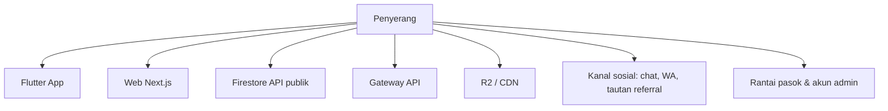

# Attack Surface — Campus Express

Peta ini mendaftar setiap titik masuk yang dapat dijangkau penyerang, siapa yang bisa menjangkaunya, dan kontrol yang menjaganya. Gunakan bersama `threat-model.md` (ID ancaman dirujuk pada kolom terakhir).

## 1. Ikhtisar

| Permukaan | Terbuka ke | Kekritisan |
|---|---|---|
| Flutter app | Siapa pun yang dapat mengunduh APK/IPA | Tinggi |
| Web Landing | Publik anonim | Sedang |
| Web Merchant/Admin | Pengguna terautentikasi | Tinggi |
| Firebase (Auth, Firestore, FCM) | Siapa pun yang tahu konfigurasi proyek (konfigurasi klien tidak rahasia) | Sangat tinggi |
| Trusted Gateway | Internet | Sangat tinggi |
| Cloudflare R2 dan CDN | Internet (publik) / Gateway (privat) | Tinggi |
| Chat | Pengguna terautentikasi | Tinggi |
| Akun pengembang/admin | Phishing, pencurian token | Sangat tinggi |

## 2. Flutter App

| Vektor | Deskripsi | Kontrol | Ancaman |
|---|---|---|---|
| Rekayasa balik APK | Ekstraksi konfigurasi Firebase, endpoint, logika | Obfuscation; tidak ada rahasia di klien; semua keputusan sensitif di server | T-04, T-71 |
| Modifikasi APK/klien palsu | Klien yang dimodifikasi mengirim data bohong | App Check; validasi server; rules ketat | T-04, T-10 |
| Penyimpanan lokal | Cache Firestore dan preferensi dapat dibaca di perangkat root | Tidak menyimpan PIN/token manual; data cache non-sensitif | T-17 |
| Tangkapan layar | PIN dan bukti bayar terekam | `FLAG_SECURE` pada layar tertentu | T-17 |
| Deep link | Parameter berbahaya membuka layar/aksi tak semestinya | Validasi host dan parameter, tidak ada aksi mutasi via deep link | T-52 |
| Notifikasi FCM | Payload memuat data sensitif | Payload hanya ID dan jenis; detail diambil setelah autentikasi | T-35 |
| Sideloading | Distribusi APK tidak resmi | Distribusi lewat Play Store; cek versi minimum | T-04 |
| Overlay/tapjacking pada tombol Klaim | Klik tidak disengaja | Konfirmasi geser untuk aksi finansial (Selesai, Top-Up) | — |

## 3. Web Next.js

| Vektor | Deskripsi | Kontrol | Ancaman |
|---|---|---|---|
| XSS | Data ulasan/nama produk dirender | Escape default React; larangan `dangerouslySetInnerHTML`; CSP | T-34 |
| CSRF | Panel admin memakai sesi | Token ID Bearer di header (bukan cookie otomatis), `SameSite=Strict` bila memakai cookie | T-03 |
| Clickjacking | Panel di-embed | `frame-ancestors 'none'` | — |
| Endpoint publik | Scraping, lonjakan trafik | Cache edge, data anonim, rate limit | T-50, T-51 |
| Referral | Tautan `/r/{kode}` dimanipulasi | Validasi pola kode, reward oleh server | T-52 |
| Variabel lingkungan klien | Kebocoran rahasia lewat `NEXT_PUBLIC_*` | Hanya konfigurasi publik; pemindaian rahasia | T-71 |
| Dependensi npm | Paket berbahaya | Lockfile, audit, Dependabot | T-70 |
| Panel Admin | Target utama pengambilalihan | Custom claim, Cloudflare Access, 2FA | T-03, T-72 |

## 4. Firebase

### 4.1 Auth

| Vektor | Kontrol | Ancaman |
|---|---|---|
| Pendaftaran dengan email domain lain | Cek domain di rules/Gateway; hanya penyedia Google | T-01 |
| Pencurian ID token | Token berumur 1 jam; verifikasi `aud`/`iss`; cabut token saat suspend | T-72 |
| Enumerasi pengguna | Tidak ada endpoint pencarian pengguna; `nimIndex` tidak dapat dibaca klien | T-02 |

### 4.2 Firestore

| Koleksi | Baca oleh | Tulis oleh | Risiko jika rules salah |
|---|---|---|---|
| `users` | Pemilik, admin | Pemilik (field terbatas), Gateway | Kebocoran data pribadi, eskalasi peran |
| `orders` | Peserta, driver (hanya `AWAITING_DRIVER`) | Peserta (transisi terbatas), Gateway | Manipulasi harga/status |
| `orders/*/secrets` | Konsumen | Gateway | PIN bocor |
| `chats/*/messages` | Peserta | Peserta | Penyadapan, spam |
| `wallets`, `walletTx` | Pemilik, admin | Gateway | Pencurian saldo |
| `merchantMenus` | Terautentikasi | Pemilik merchant | Perusakan katalog |
| `config`, `landmarks`, `fareMatrix` | Terautentikasi | Admin | Manipulasi tarif |
| `salesPings`, `stats` | Publik via Gateway | Gateway | Disinformasi tampilan |

Vektor khusus Firestore: query tanpa filter yang memicu pembacaan massal (cegah dengan rules membatasi `list` pada kondisi pemilik), eksploitasi `get()` dalam rules yang mahal (batasi jumlah `get()` per rule), dan penyalahgunaan kuota (T-60).

### 4.3 FCM

Token perangkat disimpan di `users.fcmTokens` (maks. 5). Pengiriman hanya oleh Gateway. Kontrol: tidak ada topik publik yang dapat dilanggani klien untuk data sensitif.

## 5. Trusted Gateway

| Endpoint | Metode | Autentikasi | Peran | Risiko utama | Kontrol |
|---|---|---|---|---|---|
| `/orders/:id/finalize` | POST | ID token | Konsumen pemilik | Manipulasi harga | Hitung ulang server |
| `/orders/:id/claim` | POST | ID token | Driver approved | Race, bypass saldo | Transaksi + cek saldo |
| `/orders/:id/complete` | POST | ID token | Driver/Merchant order | Selesai palsu, brute PIN | PIN, batas percobaan |
| `/orders/:id/cancel` | POST | ID token | Peserta | Penyalahgunaan strike | Aturan pembatalan di server |
| `/upload/:kind` | PUT | ID token | Sesuai jenis | Berkas berbahaya, pengisian penyimpanan | Magic bytes, kuota, 80 KB |
| `/files/:key` | GET | ID token | Admin/Pemilik | IDOR pada KTM/SIM | Cek kepemilikan/peran, URL 5 menit |
| `/wallet/topup` | POST | ID token | Driver | Bukti ganda | Hash bukti, idempotensi |
| `/admin/topup/:id/approve` | POST | ID token + claim admin | Admin | Penyalahgunaan insider | Dua persetujuan, audit |
| `/admin/users/:uid/suspend` | POST | ID token + claim admin | Admin | Pengambilalihan | Audit, 2FA |
| `/referrals/code` | POST | ID token | Terautentikasi | Pembuatan massal | Satu kode per akun |
| `/public/pings`, `/public/stats`, `/public/reviews` | GET | Tidak ada | Publik | Scraping, DoS | Cache 30 dtk, data anonim |
| `/cron/*` | Terjadwal | Pemicu internal | Sistem | Dipanggil dari luar | Hanya pemicu Cron, tolak permintaan HTTP biasa |

Vektor umum: injeksi parameter (validasi zod), IDOR (selalu cocokkan `uid` dengan peserta order), replay (idempotensi + kedaluwarsa token), header spoofing (jangan percaya `X-Forwarded-*` untuk otorisasi), pembocoran kesalahan (respon generik).

## 6. Cloudflare R2

| Vektor | Kontrol | Ancaman |
|---|---|---|
| Bucket privat terbuka karena salah konfigurasi | Dua bucket, tidak ada domain publik pada `ce-private`, audit konfigurasi rutin | T-40 |
| Tebak nama objek | Nama UUID v4, tidak ada listing | T-40 |
| Hotlinking aset publik | Aturan WAF Referer, cache panjang | T-42 |
| Kredensial R2 bocor | Hanya Worker (binding), tanpa kunci S3 di klien; jika kunci S3 diperlukan, di secret manager | T-71 |
| Unggahan SVG/HTML | Hanya WebP diterima | T-41 |
| Pengumpulan data (scraping gambar) | Tidak ada data pribadi pada bucket publik | — |

## 7. Chat

| Vektor | Kontrol | Ancaman |
|---|---|---|
| Penyadapan pesan | Rules `participants`, TTL | T-31 |
| Spam/banjir | Rate limit, batas panjang, kill switch | T-33 |
| Spoofing pengirim | `senderUid == auth.uid` | T-32 |
| Phishing/tautan berbahaya | Tautan tidak otomatis dibuka; peringatan domain eksternal | T-36 |
| Gambar tidak pantas | Laporan, tinjauan admin, hapus gambar | T-30 |
| Rekayasa sosial meminta PIN | Peringatan permanen, edukasi | T-36 |
| WhatsApp fallback | Hanya tersedia bila chat gagal; nomor dibagikan terbatas pada peserta order | T-35 |

## 8. Operasi dan Rantai Pasok

| Vektor | Kontrol |
|---|---|
| Akun GitHub/Cloudflare/Firebase/Play | 2FA, passkey bila tersedia, hak minimum |
| Token CI | Secret per lingkungan, rotasi 90 hari |
| Dependensi Dart/npm | Lockfile, Dependabot, pinning versi |
| Phishing ke admin | Pelatihan singkat, akses Admin lewat Cloudflare Access |
| Keystore Android hilang/dicuri | Cadangan terenkripsi, Play App Signing |

## 9. Prioritas Pengujian

| Prioritas | Pengujian | Frekuensi |
|---|---|---|
| 1 | Tes rules dengan emulator untuk semua koleksi dan transisi | Tiap commit |
| 2 | Tes keamanan Gateway: IDOR, replay, konkurensi klaim | Tiap commit |
| 3 | Uji unggah berkas berbahaya | Tiap rilis |
| 4 | Pemindaian rahasia dan dependensi | Tiap commit dan mingguan |
| 5 | Uji penetrasi ringan panel Admin dan alur dompet | Sebelum pilot terbuka |
| 6 | Latihan insiden (kebocoran kunci, kuota habis) | Per semester |