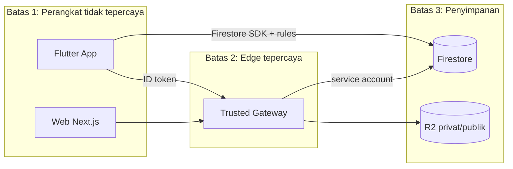

# Threat Model — Campus Express (STRIDE)

## 1. Ruang Lingkup

| Item | Isi |
|---|---|
| Sistem | Flutter app, Next.js (Landing/Merchant/Admin), Firebase (Auth, Firestore, FCM), Trusted Gateway (Workers), Cloudflare R2 |
| Aset utama | Identitas mahasiswa (NIM, email), KTM/SIM driver, saldo wallet dan ledger, integritas status order, PIN serah-terima, isi chat, kuota gratis (aset operasional) |
| Aktor ancaman | Konsumen nakal, driver nakal, merchant nakal, penyerang eksternal, penyalahgunaan oleh admin, bot/scraper |
| Di luar lingkup | Keamanan fisik perangkat pengguna, kompromi akun Google di sisi Google, kejahatan fisik antar pengguna di jalan (ditangani lewat kebijakan dan Help Desk) |

## 2. Diagram Aliran Data dan Batas Kepercayaan

Semua yang melewati Batas 1 dianggap tidak tepercaya. Kontrol penting berada di Rules (Firestore) dan Gateway.

## 3. Analisis STRIDE per Komponen

Skor risiko: Kemungkinan (K) × Dampak (D) masing-masing 1–3 (rendah–tinggi). Risiko = K×D; ≥ 6 = tinggi.

### 3.1 Autentikasi dan Akun

| ID | STRIDE | Ancaman | K | D | Risiko | Mitigasi |
|---|---|---|---|---|---|---|
| T-01 | Spoofing | Penyerang memakai akun Google non-kampus | 2 | 2 | 4 | Validasi domain + `email_verified` di rules dan Gateway |
| T-02 | Spoofing | Satu orang membuat banyak akun (farming referral, pembatalan tanpa strike) | 3 | 2 | 6 | NIM unik via `nimIndex`, reward referral hanya setelah order selesai ≥ Rp 10.000, pemantauan perangkat sama |
| T-03 | Elevation | Pengguna mencoba menjadi admin dengan mengubah dokumen `users` | 2 | 3 | 6 | `roles` tidak dapat ditulis klien; admin hanya via custom claim; rules menolak field peran |
| T-04 | Spoofing | Aplikasi tiruan memanggil Firestore/Gateway | 2 | 2 | 4 | App Check (Play Integrity) pada keduanya |

### 3.2 Order dan Pembayaran

| ID | STRIDE | Ancaman | K | D | Risiko | Mitigasi |
|---|---|---|---|---|---|---|
| T-10 | Tampering | Klien mengubah harga/ongkir pada order | 3 | 3 | 9 | Finalisasi server menghitung ulang dari `fareMatrix` dan `merchantMenus`; order tidak terlihat driver sebelum `finalized` |
| T-11 | Tampering | Transisi status ilegal (melompat ke `COMPLETED`) | 3 | 3 | 9 | Rules `hasOnly` per transisi; `COMPLETED` hanya via Gateway dengan PIN |
| T-12 | Repudiation | Konsumen menyangkal order atau driver menyangkal serah-terima | 2 | 2 | 4 | Event audit append-only, PIN, chat, e-receipt |
| T-13 | Fraud | Order iseng (prank) membuat driver menalangi | 3 | 2 | 6 | Batas 2 order aktif, QRIS wajib bukti untuk nilai tinggi, strike, driver dapat melihat riwayat strike/rating konsumen (ringkas) |
| T-14 | Fraud | Bukti QRIS palsu atau tidak masuk | 3 | 2 | 6 | Penerima wajib menekan konfirmasi; order tidak berjalan sebelum itu; dispute dengan bukti; strike |
| T-15 | Fraud | Kolusi konsumen–driver untuk memalsukan order demi reward/ulasan | 2 | 2 | 4 | Reward non-tunai, deteksi pasangan konsumen–driver berulang, ulasan hanya dari order selesai |
| T-16 | Tampering | Driver menyelesaikan order tanpa serah-terima | 2 | 3 | 6 | PIN hanya terlihat oleh konsumen; batas percobaan; lokasi checkpoint dan chat sebagai bukti |
| T-17 | Info Disclosure | PIN bocor lewat chat atau tangkapan layar | 2 | 2 | 4 | Peringatan permanen, `FLAG_SECURE`, PIN sekali pakai per order |
| T-18 | DoS | Brute force PIN | 2 | 2 | 4 | 5 percobaan, kunci 10 menit, event `PIN_LOCKED` |
| T-19 | Race | Dua driver klaim bersamaan | 3 | 2 | 6 | Transaksi Firestore di Gateway |

### 3.3 Wallet

| ID | STRIDE | Ancaman | K | D | Risiko | Mitigasi |
|---|---|---|---|---|---|---|
| T-20 | Tampering | Klien menulis saldo | 2 | 3 | 6 | `wallets` dan `walletTx` tulis klien dilarang |
| T-21 | Fraud | Bukti top-up palsu | 3 | 2 | 6 | Persetujuan admin dengan pencocokan mutasi rekening; dua persetujuan untuk ≥ Rp 200.000; `idempotencyKey` |
| T-22 | Tampering | Komisi dipotong dua kali atau tidak sama sekali | 2 | 2 | 4 | `idempotencyKey = commission:{orderId}`; rekonsiliasi harian: Σ komisi ledger = Σ komisi order selesai |
| T-23 | Insider | Admin menyetujui top-up fiktif | 1 | 3 | 3 | Dua persetujuan nominal besar, `auditLogs`, tinjauan mingguan |

### 3.4 Chat

| ID | STRIDE | Ancaman | K | D | Risiko | Mitigasi |
|---|---|---|---|---|---|---|
| T-30 | Harassment | Pelecehan, ancaman, konten seksual | 3 | 3 | 9 | Filter kata, laporan satu ketukan, blokir, SLA admin 24 jam, suspend langsung kasus berat |
| T-31 | Info Disclosure | Pengguna non-partisipan membaca chat | 2 | 3 | 6 | Rules `participants`; ruang hanya dibuat Gateway |
| T-32 | Spoofing | Pesan atas nama pengguna lain | 2 | 2 | 4 | `senderUid == auth.uid` di rules |
| T-33 | DoS | Banjir pesan menghabiskan kuota tulis | 3 | 2 | 6 | Rate limit klien dan Gateway untuk gambar; batas 500 karakter; kill switch `chatEnabled` |
| T-34 | Tampering | Skrip/XSS melalui pesan | 2 | 2 | 4 | Render teks polos; tidak ada HTML |
| T-35 | Info Disclosure | Pesan menyimpan data pribadi terlalu lama | 2 | 2 | 4 | TTL 30 hari, peringatan privasi |
| T-36 | Social engineering | "Admin" palsu meminta PIN | 2 | 3 | 6 | Aplikasi tidak pernah meminta PIN; admin tidak masuk chat order; banner edukasi |

### 3.5 Berkas (R2)

| ID | STRIDE | Ancaman | K | D | Risiko | Mitigasi |
|---|---|---|---|---|---|---|
| T-40 | Info Disclosure | Kebocoran KTM/SIM | 2 | 3 | 6 | Bucket privat, URL bertanda tangan 5 menit, akses admin tercatat, retensi terbatas |
| T-41 | Tampering | Unggah berkas berbahaya menyamar sebagai gambar | 2 | 2 | 4 | Magic bytes, konversi WebP, batas ukuran, tidak pernah dieksekusi/di-render sebagai HTML |
| T-42 | DoS | Pengisian penyimpanan/operasi R2 | 2 | 2 | 4 | Kuota unggah harian per UID, rate limit |
| T-43 | Info Disclosure | EXIF memuat lokasi | 2 | 1 | 2 | Hapus metadata saat konversi |

### 3.6 Landing dan Endpoint Publik

| ID | STRIDE | Ancaman | K | D | Risiko | Mitigasi |
|---|---|---|---|---|---|---|
| T-50 | Info Disclosure | Sales Pings membocorkan identitas | 2 | 2 | 4 | Hanya label menu dan landmark; tanpa nama atau waktu presisi |
| T-51 | DoS | Lonjakan trafik menguras kuota baca | 3 | 2 | 6 | Cache edge 30 detik; bagian dinamis opsional |
| T-52 | Tampering | Manipulasi tautan referral | 2 | 1 | 2 | Kode divalidasi, reward diberikan server |

### 3.7 Biaya dan Ketersediaan (Denial of Wallet)

| ID | STRIDE | Ancaman | K | D | Risiko | Mitigasi |
|---|---|---|---|---|---|---|
| T-60 | DoS | Penyerang menghabiskan kuota Firestore harian | 3 | 3 | 9 | Auth wajib, App Check, rate limit, query berbatas, peringatan 70/90%, kill switch fitur |
| T-61 | Cost | Tagihan melonjak setelah Blaze | 2 | 3 | 6 | Anggaran peringatan rendah, batas pengeluaran manual, pembatasan tulis klien |

### 3.8 Rantai Pasok dan Operasi

| ID | STRIDE | Ancaman | K | D | Risiko | Mitigasi |
|---|---|---|---|---|---|---|
| T-70 | Tampering | Dependensi berbahaya | 2 | 3 | 6 | Lockfile, Dependabot, audit rutin |
| T-71 | Info Disclosure | Rahasia bocor di repo | 2 | 3 | 6 | Pemindaian rahasia, `secrets.md` |
| T-72 | Elevation | Akun pengembang diambil alih | 2 | 3 | 6 | 2FA, hak minimum, tidak ada token jangka panjang |

## 4. Rencana Mitigasi Kecurangan Order

| Skenario | Sinyal deteksi | Tindakan otomatis | Tindakan manual |
|---|---|---|---|
| Order iseng | ≥ 2 order dibatalkan setelah klaim dalam sehari | Strike, batas order aktif | Tinjau pola, suspend |
| Driver menghilang | Tidak ada checkpoint/chat 10 menit setelah `AT_PICKUP` | Dispute otomatis, strike | Hubungi driver, putusan |
| Harga tidak wajar | Selisih struk > Rp 5.000 tanpa persetujuan chat | Tandai order | Mediasi |
| Pasangan kolusi | Pasangan konsumen–driver sama > 5× per minggu | Tandai untuk tinjauan | Cabut reward bila terbukti |
| Bukti QRIS sama dipakai ulang | Hash gambar identik pada order berbeda | Tolak unggah | Strike |
| Pemotongan komisi dihindari | Order selesai tanpa komisi | Rekonsiliasi harian menandai | Koreksi manual tercatat |

Hash bukti dibandingkan dengan perceptual hash sederhana di Gateway pada saat unggah.

## 5. Rencana Mitigasi Pelecehan di Chat

| Tahap | Mekanisme |
|---|---|
| Pencegahan | Pedoman dalam onboarding, Quick Chips untuk koordinasi umum, tidak ada chat di luar order |
| Deteksi | Filter kata, laporan pengguna, pemantauan lonjakan laporan per akun |
| Respons | Peringatan otomatis (ringan), strike dan tinjauan 24 jam (sedang), suspend dan pengamanan bukti (berat) |
| Pemulihan | Pelapor dapat memblokir dan mengakhiri interaksi; opsi tindak lanjut lewat pihak kampus |
| Pencegahan ulang | Riwayat pelanggaran memengaruhi persetujuan driver; akun suspend tidak dapat mendaftar ulang dengan NIM sama |

## 6. Risiko Residual

| Risiko | Alasan diterima | Rencana |
|---|---|---|
| Chat tidak E2EE | Dibutuhkan untuk dispute | Pemberitahuan jelas, retensi pendek |
| Verifikasi top-up manual | Tanpa payment gateway berarti biaya nol | Otomatisasi saat volume menuntut |
| Penipuan COD kecil | Batas Rp 200.000 dan strike | Pemantauan |
| Pelacakan checkpoint bukan GPS | Menghemat kuota dan baterai | Evaluasi GPS terbatas pasca pilot |

## 7. Peninjauan

Model ini ditinjau setiap rilis minor dan setiap kali ada fitur baru yang menambah permukaan serangan. Penanggung jawab: Security Champion tim. Setiap insiden menghasilkan satu baris ancaman baru atau pembaruan skor.